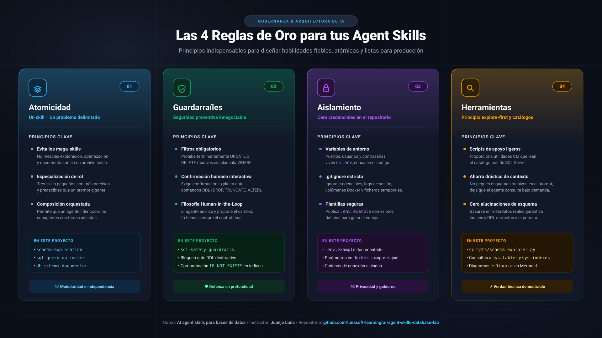

# Las 4 Reglas de Oro para tus Agent Skills

---

## 1. Mapa de Principios y Arquitectura

```mermaid
flowchart TD
    subgraph S1 ["01. Atomicidad Funcional"]
        A1["🎯 Un skill = Un problema bien delimitado"]
        A2["🧩 Evita mega-skills: separa exploración, optimización y documentación"]
        A3["📦 En el proyecto:<br/>• schema-exploration<br/>• sql-query-optimizer<br/>• db-schema-documenter"]
        A1 --> A2 --> A3
    end

    subgraph S2 ["02. Blindaje y Guardarraíles"]
        B1["🛡️ Seguridad preventiva innegociable"]
        B2["⛔ Prohibido UPDATE o DELETE sin WHERE explícito"]
        B3["🙋‍♂️ Confirmación humana ante DDL destructivo (DROP, TRUNCATE)"]
        B1 --> B2 --> B3
    end

    subgraph S3 ["03. Aislamiento de Secretos"]
        C1["🔐 Cero credenciales en el repositorio"]
        C2["📁 Secretos, puertos y usuarios en archivo .env"]
        C3["📄 .env.example como plantilla pública y .gitignore estricto"]
        C1 --> C2 --> C3
    end

    subgraph S4 ["04. Herramientas de Catálogo"]
        D1["⚡ Principio explore-first contra alucinaciones"]
        D2["🔍 Scripts ligeros que leen metadatos técnicos reales"]
        D3["📊 scripts/schema_explorer.py y vistas sys.tables / sys.indexes"]
        D1 --> D2 --> D3
    end

    classDef cCyan fill:#0c253b,stroke:#38bdf8,stroke-width:2px,color:#f8fafc;
    classDef cEmerald fill:#092e1e,stroke:#10b981,stroke-width:2px,color:#f8fafc;
    classDef cPurple fill:#241038,stroke:#a855f7,stroke-width:2px,color:#f8fafc;
    classDef cAmber fill:#2d1b04,stroke:#f59e0b,stroke-width:2px,color:#f8fafc;

    class S1,A1,A2,A3 cCyan;
    class S2,B1,B2,B3 cEmerald;
    class S3,C1,C2,C3 cPurple;
    class S4,D1,D2,D3 cAmber;
```

---

## 2. Resumen de las 4 Reglas de Oro

| # | Regla de Oro | Objetivo Principal | Implementación en este Repositorio |
| :---: | :--- | :--- | :--- |
| **01** | **Atomicidad Funcional** | Mantener cada skill enfocado en una única responsabilidad de dominio. | Separación de `schema-exploration`, `sql-query-optimizer` y `db-schema-documenter`. |
| **02** | **Blindaje y Guardarraíles** | Proteger la base de datos contra borrados masivos o cambios destructivos accidentales. | `sql-safety-guardrails` con bloqueo estricto de DDL sin confirmación interactiva. |
| **03** | **Aislamiento de Secretos** | Evitar fugas de contraseñas o cadenas de conexión en el control de versiones. | `.env` protegido por `.gitignore` y `.env.example` versionado como plantilla. |
| **04** | **Herramientas de Catálogo** | Proporcionar utilidades ligeras para inspeccionar el catálogo real en lugar de sobrecargar la ventana de contexto. | `scripts/schema_explorer.py` y consultas directas al catálogo del sistema T-SQL. |

---

## 3. Repositorio y Comunidad

- **Repositorio oficial de soluciones**: [github.com/lunasoft-learning/ai-agent-skills-database-lab](https://github.com/lunasoft-learning/ai-agent-skills-database-lab)
- **Directorio de Agent Skills abiertos**: [skillsmp.com](https://skillsmp.com)
