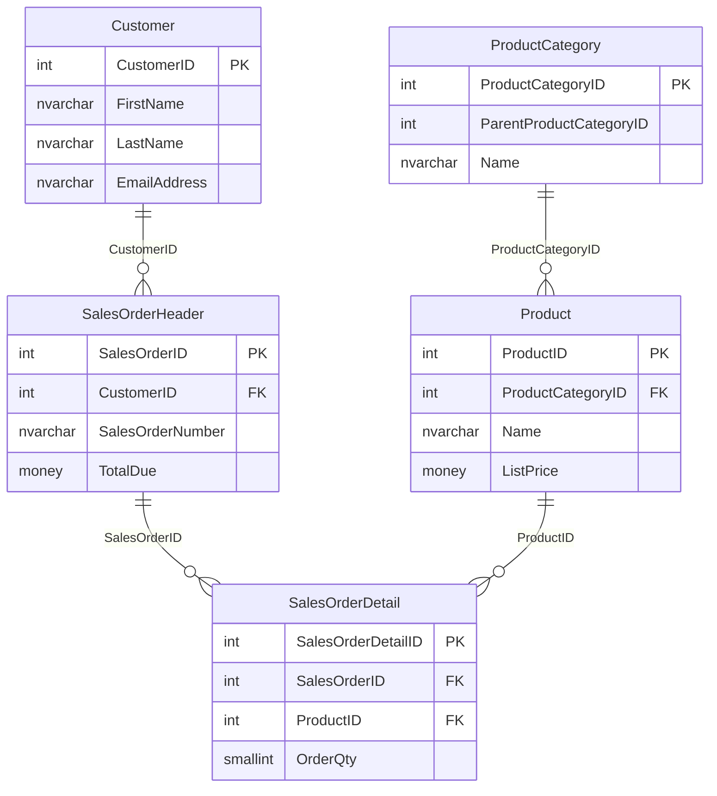

# Esquema de la base de datos AdventureWorksLT

## Resumen

- **Base de datos:** `AdventureWorksLT`
- **Servidor:** `localhost,1433`
- **Esquema principal:** `SalesLT`
- **Tablas:** 5
- **Vistas definidas por el usuario:** ninguna
- **Funciones definidas por el usuario:** ninguna

## Tablas

### `SalesLT.Customer`

| Columna | Tipo | Nulabilidad | Clave |
| --- | --- | --- | --- |
| `CustomerID` | `int` | NOT NULL | PK |
| `Title` | `nvarchar(8)` | NULL | |
| `FirstName` | `nvarchar(50)` | NOT NULL | |
| `MiddleName` | `nvarchar(50)` | NULL | |
| `LastName` | `nvarchar(50)` | NOT NULL | |
| `CompanyName` | `nvarchar(128)` | NULL | |
| `EmailAddress` | `nvarchar(50)` | NULL | |
| `Phone` | `nvarchar(25)` | NULL | |
| `ModifiedDate` | `datetime` | NULL | |

### `SalesLT.ProductCategory`

| Columna | Tipo | Nulabilidad | Clave |
| --- | --- | --- | --- |
| `ProductCategoryID` | `int` | NOT NULL | PK |
| `ParentProductCategoryID` | `int` | NULL | |
| `Name` | `nvarchar(50)` | NOT NULL | |
| `ModifiedDate` | `datetime` | NULL | |

> `ParentProductCategoryID` permite representar una categoría padre, pero no aparece como clave foránea declarada en la base de datos consultada.

### `SalesLT.Product`

| Columna | Tipo | Nulabilidad | Clave |
| --- | --- | --- | --- |
| `ProductID` | `int` | NOT NULL | PK |
| `Name` | `nvarchar(50)` | NOT NULL | |
| `ProductNumber` | `nvarchar(25)` | NOT NULL | |
| `Color` | `nvarchar(15)` | NULL | |
| `StandardCost` | `money` | NOT NULL | |
| `ListPrice` | `money` | NOT NULL | |
| `Size` | `nvarchar(5)` | NULL | |
| `Weight` | `decimal(8,2)` | NULL | |
| `ProductCategoryID` | `int` | NULL | FK |
| `SellStartDate` | `datetime` | NOT NULL | |
| `SellEndDate` | `datetime` | NULL | |
| `ModifiedDate` | `datetime` | NULL | |

### `SalesLT.SalesOrderHeader`

| Columna | Tipo | Nulabilidad | Clave |
| --- | --- | --- | --- |
| `SalesOrderID` | `int` | NOT NULL | PK |
| `OrderDate` | `datetime` | NOT NULL | |
| `DueDate` | `datetime` | NULL | |
| `ShipDate` | `datetime` | NULL | |
| `Status` | `tinyint` | NOT NULL | |
| `SalesOrderNumber` | `nvarchar(25)` | NOT NULL | |
| `CustomerID` | `int` | NOT NULL | FK |
| `SubTotal` | `money` | NOT NULL | |
| `TaxAmt` | `money` | NOT NULL | |
| `Freight` | `money` | NOT NULL | |
| `TotalDue` | `money` | NOT NULL | |
| `Comment` | `nvarchar(MAX)` | NULL | |
| `ModifiedDate` | `datetime` | NULL | |

### `SalesLT.SalesOrderDetail`

| Columna | Tipo | Nulabilidad | Clave |
| --- | --- | --- | --- |
| `SalesOrderDetailID` | `int` | NOT NULL | PK |
| `SalesOrderID` | `int` | NOT NULL | FK |
| `OrderQty` | `smallint` | NOT NULL | |
| `ProductID` | `int` | NOT NULL | FK |
| `UnitPrice` | `money` | NOT NULL | |
| `UnitPriceDiscount` | `money` | NOT NULL | |
| `LineTotal` | `money` | NOT NULL | |
| `ModifiedDate` | `datetime` | NULL | |

## Relaciones

| Tabla origen | Columna | Tabla destino | Columna destino |
| --- | --- | --- | --- |
| `SalesLT.Product` | `ProductCategoryID` | `SalesLT.ProductCategory` | `ProductCategoryID` |
| `SalesLT.SalesOrderHeader` | `CustomerID` | `SalesLT.Customer` | `CustomerID` |
| `SalesLT.SalesOrderDetail` | `SalesOrderID` | `SalesLT.SalesOrderHeader` | `SalesOrderID` |
| `SalesLT.SalesOrderDetail` | `ProductID` | `SalesLT.Product` | `ProductID` |

## Diagrama entidad-relación

## Resumen de cardinalidades

- Un cliente puede tener muchos pedidos.
- Un pedido puede tener muchas líneas de detalle.
- Un producto puede aparecer en muchas líneas de pedido.
- Una categoría puede contener muchos productos.
